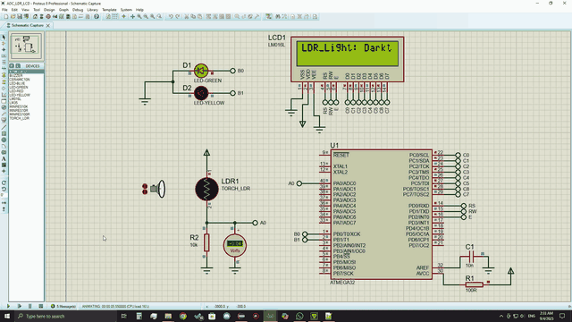

# AVR ATmega32 Drivers — MG Architecture

> **Plug-and-Play, Register-Level Embedded C Drivers for Microchip AVR ATmega32.**  
> Engineered from scratch using a modular **Layered Architecture (`LIB` → `MCAL` → `HAL` → `APP`)** for clean integration, high readability, and zero hardware dependency in application code.


---

## Why Use This Repository?
* **Zero Dependency & Portable:** Written in pure Embedded C with direct register access—no external frameworks required.
* **Strict Decoupling:** Every peripheral is isolated into standardized files (`_Interface.h`, `_Config.h`, `_Private.h`, `_Register.h`, `_Program.c`), allowing you to drop any single driver directly into your project.
* **Hardware Verified:** Tested and validated on physical **ATmega32** target hardware as well as Proteus simulation.

<p align="center">
  
</p>

---

## Architecture Layout

```text
├── LIB/      # Standard data types & bit manipulation macros
├── MCAL/     # Internal ATmega32 peripheral drivers
├── HAL/      # External hardware module drivers
└── APP/      # Ready-to-run system examples & integration tests
